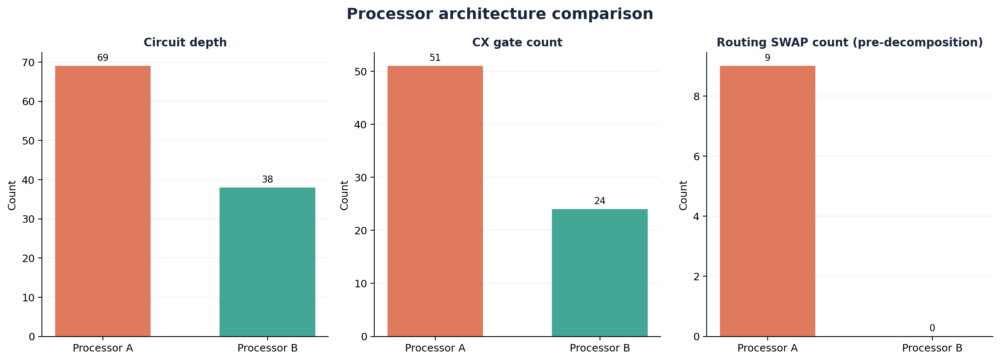

# Qiskit Fall Fest 2026 - Phase 1, PS-O1

**Selected problem:** PS-O1, Max-Cut on Weighted Graphs.  
**Team Name:** Velaris.  
**Repository:** https://github.com/stardream07/QiskitPS01

This project solves the guide's six-node weighted graph with QAOA at both allowed depths, p=1 and p=2, and compares participant-defined Processor A (5 qubits) and Processor B (9 qubits). Exact enumeration gives cut **22**. All four primary noisy runs sampled this optimum; average quality is reported separately from the best sample.

## Measured results

| p | Processor | Depth | CX | Routing SWAPs | Exact noisy mean cut | Mean ratio | P(optimum) |
| --- | --- | --- | --- | --- | --- | --- | --- |
| 1 | Processor A | 38 | 27 | 5 | 17.1530 | 0.7797 | 13.32% |
| 1 | Processor B | 21 | 12 | 0 | 17.3180 | 0.7872 | 13.88% |
| 2 | Processor A | 69 | 51 | 9 | 18.1763 | 0.8262 | 18.30% |
| 2 | Processor B | 38 | 24 | 0 | 18.5631 | 0.8438 | 19.84% |

Depth includes final measurement. SWAPs are captured after routing in the **same** pipeline that produces the simulated circuit. The exact noisy means use density matrices and readout noise; each processor also has five 4096-shot ideal/noisy evaluations (seeds 42-46), saved separately. The ratio is mean cut / 22. p=2's exact ideal mean is **19.240690**, ratio **0.874577**. A best observed cut of 22 does not imply every shot is optimal.



## Setup

The final package was executed and tested with **Python 3.14.7 on Windows**, Qiskit 2.5.0 and Aer 0.17.2. Use Python 3.14 for the supplied full environment lock.

```powershell
py -3.14 -m venv .venv
.\.venv\Scripts\python.exe -m pip install -r requirements.lock.txt
.\.venv\Scripts\python.exe -m pip check
.\.venv\Scripts\python.exe run_experiment.py
.\.venv\Scripts\python.exe -m pytest -q
.\.venv\Scripts\python.exe execute_notebook.py
.\.venv\Scripts\python.exe validate_submission.py
```

On Linux/macOS, replace the executable with `.venv/bin/python`, creating the environment with `python3.14 -m venv .venv`. Direct dependencies are pinned in `requirements.txt`; `requirements.lock.txt` also pins their transitive dependencies. Select the local `.venv` kernel when opening `main.ipynb` interactively. The saved notebook contains a complete successful run.

## Methodology and fairness

1. Generate `networkx.erdos_renyi_graph(n=6, p=0.5, seed=42)`. Assign integer weights 1-5 using `numpy.random.default_rng(42)` in sorted edge order. The guide leaves the weight seed unspecified; 42 is our documented choice.
2. Fix node 0 to bit 0 using global complement symmetry. Every full cut has an equal-value complement; this retains all cut values and the optimum while requiring five logical qubits. Verify all 64 full assignments against the 32 representatives. This reduction defines a five-qubit QAOA ansatz; it does not claim to reproduce the finite-depth state of an unreduced six-qubit mixer.
3. Build the cost Hamiltonian `C = sum w*(1-Zu*Zv)/2`, with `Z0=+1`. Use `RZ(-gamma*w)`, `RZZ(-gamma*w)`, and `RX(2*beta)`. Optimize exact expected cut with grid-seeded, 16-start COBYLA for p=1 and 16-start warm/random COBYLA for p=2. Verify the fast NumPy simulator against Qiskit Statevector.
4. Hold angles and identity initial layout fixed across A/B. Compile at optimization level **1**, transpiler seed **42**, basis **{rz, sx, x, cx}**. Check every physical CX edge and the routed measurement distribution. Capture SWAPs with an analysis-only post-routing hook.
5. Apply the same synthetic noise on both: one-qubit depolarizing **0.001** on rz/sx/x, CX depolarizing **0.005**, symmetric readout flips **0.01**. RZ is deliberately noisy under this synthetic model. No device calibration or real hardware is claimed.
6. Compare mean and best cut, mean approximation ratio, optimal-cut probability, circuit depth/CX/SWAP counts, and classical distribution fidelity. Report confidence intervals and five sampling repetitions.

## Architecture design

| Processor | Physical qubits | Undirected edges | Diameter | Maximum degree | Density |
| --- | --- | --- | --- | --- | --- |
| Processor A | 5 | 4 | 4 | 2 | 0.400 |
| Processor B | 9 | 12 | 4 | 4 | 0.333 |

Processor A uses the guide's linear-chain reference. Processor B is a connected 12-edge graph whose five-qubit core exactly contains the six interactions of this reduced instance; the four remaining physical nodes provide a sparse extension. B is a deliberately problem-specific co-design, and extra qubit count alone is not its explanation. JSON files include the connectivity, baseline configuration, noise rates and rationale. The guide permits participant-designed maps; it does not require a heavy-hex map or exactly 12 edges.

## Files and reproduction

```text
README.md                         setup, method and key measured results
main.ipynb                        executed, end-to-end notebook
requirements.txt                  pinned direct dependencies
requirements.lock.txt             full tested dependency lock
run_experiment.py                  regenerate both depths and all outputs
execute_notebook.py                execute using a fresh local kernel
validate_submission.py             audit guide requirements and evidence
build_deliverables.py              rebuild this documentation and notebook
submission.json                   selected problem, members and portal status
data/raw/                         generated weighted edge list
data/processed/                   graph, Hamiltonian and optimized angles
processors/processor_A.json        5-qubit model and benchmark config
processors/processor_B.json        9-qubit model and benchmark config
src/problem.py                    objective, Hamiltonian, classical references
src/processors.py                 topology validation and noise model
src/routing.py                    transpilation, SWAP capture and layout checks
src/qaoa.py                        circuit and parameter optimization
src/evaluation.py                  exact noisy measurement distributions
src/metrics.py                     resource, solution and fidelity metrics
src/visualization.py               saved scientific plots
results/tables/                    CSV/JSON results, test and audit evidence
results/figures/                   graphs, coupling maps and comparison plots
assets/circuits/                   portable QPY logical and physical circuits
tests/                            independent scientific correctness tests
report.md                         completed architectural analysis
```

`python run_experiment.py --depth 1` and `--depth 2` run individual depths; `--classical-only` regenerates the classical reference. `--shots`, `--seed`, `--repeats`, `--restarts` and `--maxiter` support exploratory runs; keep default settings for the final guide baseline. `--output-dir PATH` writes an experiment into a separate folder. After changing scientific settings, regenerate documentation and execute the notebook before the final audit. GitHub Actions runs tests, the notebook and the audit in a fresh Windows environment.

Each depth has a `run_manifest_p*.json` recording versions, seeds, command, source hashes and artifact hashes. Count keys are Qiskit `c4...c0`; graph assignments in exports are `node0...node5`. Source hashes detect stale results. Cross-machine floating-point or compiler changes can cause slight variation; the lock and manifests record the tested environment.

## Limitations and submission

The graph is small enough to solve exactly classically. This is an architecture experiment, with no quantum speedup claim. Low-depth QAOA and multistart search do not guarantee a global variational optimum. Processor B is tailored to one graph; synthetic independent noise omits relaxation, crosstalk, timing and calibration drift. Distribution fidelity is a **classical measurement-distribution** metric, not quantum state fidelity.

Read [report.md](report.md) for the full quantitative analysis.
